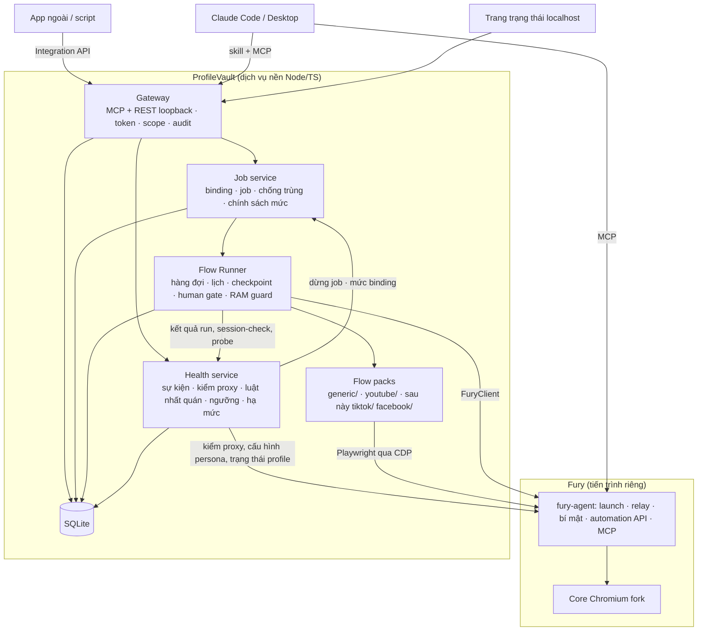

# ProfileVault — Tài liệu thiết kế kiến trúc

**Phiên bản:** 1.3 · **Ngày:** 14/10/2026 · **Tác giả:** Tan · **PRD tương ứng:** `profilevault-prd.md` v1.3 · **Spec:** `specs/`

Tài liệu ở mức kiến trúc: thành phần, ranh giới, hợp đồng và quyết định chính. Yêu cầu sản phẩm ở PRD; schema, tool, mã lỗi, selector, UI ở các spec.

---

## 1. Mục tiêu và phạm vi

**Sản phẩm.** Dịch vụ nền trên Windows (tray, tự khởi động cùng Windows để lịch chạy và job từ app khác không phụ thuộc người mở) chạy cạnh **Fury Antidetect Browser** (mã nguồn mở, AGPL-3.0; nhân Chromium vá vân tay ở tầng C++), bổ sung ba thứ Fury không có: **flow RPA tất định** chạy trên profile của Fury, **Integration API** để app khác gửi việc, và **skill** để Claude vận hành bằng ngôn ngữ tự nhiên. Use case đầu tiên: upload video YouTube; kiến trúc không gắn với YouTube.

**Người dùng và quy mô mục tiêu:** một người vận hành (tác giả) quản lý ~5–10 kênh YouTube, **mỗi kênh một tài khoản Google (email) riêng và một profile Fury riêng**, mỗi ngày vài upload; sau này có thể thêm 1–2 VA dùng qua Fury team mode (M3). Máy: Windows, RTX 5060 Ti 16 GB, RAM 32 GB, chạy cùng các app sản xuất video. Phần mềm bắt buộc: Fury (bản Windows chưa ký số, SmartScreen "Run anyway"), Node 22; gói Claude cần từ M2 (skill).

**Phân công**

| Fury làm | ProfileVault làm |
|---|---|
| Profile tách biệt, vân tay tầng nhân (nhất quán bên trong trình duyệt), proxy, bundle mã hóa, sync, team/RBAC, nhóm/tag, audit profile, tạo hàng loạt, API mở/đóng profile, probe, MCP | Mức tự động hóa L0–L3 theo binding; Health service (sự kiện, kiểm proxy, kiểm tra độ nhất quán, ngưỡng, hạ mức) + dashboard; flow pack theo nền tảng; runner (hàng đợi, lịch, checkpoint, human gate); job service; Integration API; chính sách job; skill |

**Ngoài phạm vi:** làm lại thứ Fury đã có; sửa mã Fury (chỉ đóng góp upstream); API chính thức của nền tảng (dùng RPA trong phiên thật); tự đặt nội dung công khai; giải CAPTCHA; tương tác giả.

---

## 2. Nguyên tắc

1. **Không thiết kế lại thứ Fury đã có;** Fury là tiến trình riêng, gọi qua API (không nhúng code, tránh AGPL kéo theo).
2. **Flow là code** (TypeScript + Playwright) theo một hợp đồng nhỏ; không có engine đồ thị. Lý do: tác giả viết code bằng AI, Claude Code sửa flow nhanh hơn kéo thả; có trace viewer và test sẵn.
3. **Lõi không biết nền tảng.** Runner, job, API, skill router làm việc với *flow pack*; YouTube chỉ là pack đầu tiên.
4. **Tất định trước, AI sau:** selector ngữ nghĩa là chính; AI (Stagehand có cache) chỉ cho bước đánh dấu dễ vỡ.
5. **Con người quyết định phát hành.** Flow dừng ở trạng thái riêng tư/nháp; linter của Runner chặn bước đặt công khai ở **mọi** pack (chính thức lẫn người dùng).
6. **Bí mật ở Fury.** ProfileVault không giữ cookie, mật khẩu, proxy; chỉ giữ token của chính nó, token Fury và khóa LLM (cho `ai`), đều qua DPAPI. Email/số khôi phục trong checklist chỉ lưu dạng băm để so trùng.
7. **Một profile một việc tại một thời điểm,** kể cả khi việc đó do Claude mở trực tiếp qua Fury (live mode): Runner hỏi trạng thái profile ở Fury trước khi chạy, profile đang mở bởi người khác → `waiting_profile`. Đồng thời theo RAM; việc lâu bất đồng bộ, có checkpoint, có audit.
8. **Tự động hóa mở dần theo bằng chứng:** mỗi binding có mức L0 (thủ công, không CDP) → L1 (quan sát, session-check chỉ đọc) → L2 (bán tự động, dừng trước nút cuối) → L3 (tự động). Lên mức cần đạt ngưỡng + người xác nhận; cờ đỏ tự hạ mức và dừng job.
9. **Nhất quán bên trong trình duyệt là việc của Fury; nhất quán giữa profile và thế giới bên ngoài là việc của ProfileVault.** Fury bảo đảm persona từ máy thật, giá trị đồng nhất giữa trang/Worker/iframe, nhiễu tất định. ProfileVault kiểm profile khớp mạng, máy chạy, tài khoản, các profile khác và chính nó theo thời gian; chỉ báo và chặn, không tự sửa cấu hình profile.
10. **Kiểm soát nâng cấp là việc của ProfileVault:** ghim phiên bản Fury được hỗ trợ; nâng Fury chỉ sau khi detect-suite và hồi quy flow xanh; không bao giờ tự nâng.

---

## 3. Kiến trúc tổng thể



**Giao diện:** Fury có app desktop cho profile/proxy/team. ProfileVault có giao diện localhost với **dashboard độ sẵn sàng** (mức, tiến độ tới ngưỡng, cờ đỏ, điểm nhất quán, dòng thời gian, biểu đồ theo kênh, ma trận chéo giữa các kênh) và trang trạng thái (job, run, log, tài khoản đã bind, lịch, token, nút tiếp tục khi chờ người dùng, khai báo sự kiện thủ công, checklist tài khoản, nhập file probe); tạo binding làm được từ trang này hoặc qua skill `account-setup`. Chat = Claude Code/Desktop, dùng đồng thời MCP của Fury (profile, mở trang, thao tác một lần) và MCP của ProfileVault (job, flow, binding).

**Hợp đồng ổn định:** Integration API `profilevault/v1` · Flow contract · Flow pack manifest · `FuryClient` (bọc 6 endpoint automation, trạng thái mở/đóng profile, cấu hình persona/múi giờ/ngôn ngữ — nguồn xác minh ở spike; ghim khoảng phiên bản Fury hỗ trợ, lệch → cảnh báo).

---

## 4. Mô hình miền

```
Workspace
  ├─ AccountBinding — tài khoản trên một nền tảng ↔ furyProfileId (+ cấu hình pack, thư mục file cho phép, automationLevel L0–L3)
  │   ├─ HealthEvent — khai báo tay, kiểm proxy, session-check, kết quả detect-suite, run, đổi mức
  │   ├─ ProbeResult — giá trị đo được trong trình duyệt (từ probe của Fury), theo phiên bản Fury
  │   ├─ AccountChecklist — vùng tài khoản, quốc gia kênh, 2FA, email/số khôi phục (băm)
  │   ├─ ConsistencyResult — kết quả từng luật (đạt/trượt, mức, giá trị thực tế, gợi ý sửa)
  │   └─ LevelChange — từ/đến, lý do, ai xác nhận
  ├─ ConsistencyRule — bộ luật cấu hình được (lớp, mức chặn/cảnh báo, tham số), có lịch sử
  ├─ FlowPack → Flow — gói theo nền tảng, mỗi flow có manifest
  ├─ Job → Run — một yêu cầu chạy flow trên một binding; Run có bước, checkpoint, artifact
  ├─ Schedule — cron → flow + target (danh sách binding, hoặc lọc binding theo tag của profile Fury)
  ├─ ClientApp — token + scope
  └─ AuditEvent
```

- Profile, proxy, nhóm, team **không nằm trong CSDL ProfileVault**; tham chiếu bằng ID của Fury.
- Khóa trao đổi với app ngoài: `platform` + ID tài khoản của nền tảng (YouTube `UC…`, TikTok username…).

---

## 5. Flow pack và Flow contract

**Flow pack** = thư mục theo nền tảng, có manifest: nền tảng, danh sách flow, cấu hình binding cần (ví dụ ngôn ngữ giao diện), yêu cầu phiên bản Fury, bộ test. Pack chính thức do ProfileVault bảo trì; pack người dùng đặt trong `extensions/flows/`.

**Flow** = module TypeScript export `manifest` (id, phiên bản, site, mức rủi ro, **mức tự động hóa tối thiểu**, schema vào/ra Zod, timeout; flow ghi có thể khai hai chế độ: dừng trước bước cuối cho L2, chạy hết cho L3) và `run(ctx, input)`. `FlowContext` cấp: `page` (Playwright, context có sẵn của profile), `step(name, fn, {retry, idempotent})` tự checkpoint và chụp trace khi lỗi, `humanGate(message)`, `log`, `artifact`, `ai` (chỉ trong bước `fragile`).

**Flow dùng chung** (pack `generic/`): `session-check` (phiên còn đăng nhập?), `probe` (mở trang probe của Fury trong profile, thu kết quả cho kiểm tra nhất quán; cần ≥ L1, ở L0 người vận hành chạy tay và nhập file), `open-and-wait` (mở trang, chờ người dùng), `read-page` (trích dữ liệu theo selector). Pack nền tảng kế thừa và thêm flow riêng: `youtube/upload`, `youtube/session-check`, sau này `tiktok/upload`…

**Soạn/sửa:** Claude Code viết từ mô tả hoặc từ phiên ghi hình (Playwright Inspector qua `page.pause()`); debug bằng trace viewer; mỗi flow có kịch bản test trên tài khoản thử nghiệm.

**Live mode** (việc một lần): Claude dùng MCP của Fury, không build; lặp ≥2 lần thì viết thành flow.

---

## 6. Runner, Health service, Job service

- **Runner:** hàng đợi SQLite; một run mỗi profile; đồng thời = min(cấu hình, RAM trống / ~500 MB); lịch cron có giờ ngẫu nhiên trong khung, chạy bù job lỡ; vòng đời `queued → waiting_profile → running(step) → needs_user → done | failed | cancelled`; resume từ checkpoint, trừ bước không idempotent đã bắt đầu. Bật CDP trên profile chỉ trong lúc chạy. **Từ chối flow có mức tối thiểu > mức binding** (`LEVEL_TOO_LOW`); binding đang bị Health service dừng → không nhận job.
- **Health service:** lưu `HealthEvent` (khai báo tay, kiểm proxy qua Fury không mở trình duyệt, session-check, detect-suite, kết quả run); tính tiến độ tới ngưỡng mức kế; áp quy tắc hạ mức (xác minh/CAPTCHA/cảnh báo/đăng xuất → L0; đổi quốc gia/ASN proxy → hạ một mức; hai binding trùng exit IP → cả hai về L0; `SITE_CHANGED` lặp → L3→L2) và quy tắc dừng job giữ nguyên mức (detect-suite đỏ; luật nhất quán *chặn* khác trượt); ngưỡng cấu hình được, mọi đổi mức vào audit.
- **Kiểm tra độ nhất quán** (trong Health service): chạy bộ luật trên dữ liệu từ Fury (cấu hình persona/proxy/múi giờ/ngôn ngữ — qua API hoặc file profile, xác minh ở spike), kiểm proxy, `ProbeResult`, thông tin máy chạy (ProfileVault tự đọc), `AccountChecklist`, và toàn bộ binding (so chéo IP, dải mạng, ASN, persona + seed, khôi phục). Kích hoạt khi tạo binding, đổi proxy/persona, nâng Fury, nhập probe mới, định kỳ, trước mỗi lần lên mức. Luật *chặn* trượt → không rời L0; ở mức cao hơn áp quy tắc ở bullet trên. Probe ở L0 do người vận hành chạy tay và nhập file; từ M1, binding ≥ L1 chạy bằng flow `generic/probe`.
- **Job service:** nhận job từ API/skill, ánh xạ `platform + account` → binding → flow; chống trùng bằng `idempotency_key` + kiểm tra phía nền tảng trong flow; xác minh file (thư mục cho phép, hash); chuẩn hóa kết quả và mã lỗi chung (`FURY_OFFLINE`, `ACCOUNT_NOT_BOUND`, `SESSION_EXPIRED`, `NEEDS_USER`, `DUPLICATE_JOB`, `SITE_CHANGED`, `POLICY_DENIED`…) cộng mã riêng của pack.

---

## 7. Integration API `profilevault/v1`

Tổng quát: `accounts.list(platform)`, `jobs.submit(flow, account, input)`, `jobs.status`, `jobs.list`, `jobs.cancel`, `flows.list`. Upload YouTube chỉ là `jobs.submit('youtube/upload', …)` với input theo schema của pack. MCP (Streamable HTTP) và REST cùng router trên loopback; token theo scope (`accounts.read`, `jobs.read`, `jobs.write`, `ops.read`, `ops.write`), giới hạn được theo flow và binding; các hành động chỉ dành cho người (lên mức, gỡ dừng, xác nhận checklist, trả lời bước duyệt L2) chỉ có trên dashboard. Package `@sctech/profilevault-contract` chứa schema chung + schema từng pack + contract test.

---

## 8. Skill cho Claude

Router `profilevault`; `account-setup` (tạo profile Fury đúng persona/proxy/múi giờ/ngôn ngữ → người dùng đăng nhập → ghim cấu hình → binding ở L0 → checklist tài khoản → probe → kiểm tra nhất quán, gợi ý sửa); `job-planner` (từ danh sách việc → gửi job, theo dõi, tổng hợp); `health-check` (đọc dashboard: mức, tiến độ, cờ đỏ, luật trượt); `flow-author` (mô tả/ghi hình → flow theo contract → test). Skill không biết nền tảng ngoài những gì pack khai báo.

---

## 9. Bảo mật, chính sách, quan sát

- Gateway chỉ loopback; token băm; scope; rate limit; audit append-only; token Fury và token client lưu qua DPAPI.
- Mức rủi ro: `read` tự chạy; `act_on_site` (mọi flow) theo scope; không có mức "công khai"/"xóa" vì ProfileVault không làm hai việc đó.
- Không chạy mã từ nội dung trang; `ai` giới hạn hành động theo manifest.
- Trace OpenTelemetry cục bộ; hồi quy vân tay dùng detect-suite của Fury khi nâng Fury; hồi quy flow hằng tuần và khi nâng Fury.

---

## 10. Lộ trình, spike, rủi ro

| Giai đoạn | Nội dung | Xong khi |
|---|---|---|
| Ngay | Cài Fury, tạo profile, đăng nhập, upload tay (không cần ProfileVault) | Bắt đầu tích lũy thời gian L0 |
| M-1 Spike (kênh test) | Đăng nhập Google giữ phiên; bật CDP và theo dõi YouTube Studio có phản ứng; script upload riêng tư đầu tiên; xác minh đọc được cấu hình persona/múi giờ/ngôn ngữ, file probe, trạng thái mở/đóng profile từ Fury | Upload riêng tư được trên profile Fury; biết nguồn dữ liệu cho kiểm tra nhất quán |
| M0 | `FuryClient`, binding + mức L0/L1, Health service (gồm kiểm tra nhất quán, nhập probe, checklist tài khoản) + dashboard, Runner (gồm linter, chặn theo mức) + lịch, pack `generic/` (session-check), SQLite, Gateway REST tối thiểu, chạy nền | Kênh thật ở L0/L1 có dữ liệu trên dashboard; hạ mức tự động hoạt động |
| M1 | Pack `youtube/upload` (L2 dừng trước nút cuối, L3 chạy hết) có test; flow `generic/probe`; Job service; Gateway MCP + token/scope; contract package; audit; trace | Kênh test ở L2/L3 upload được; app ngoài gửi job qua contract |
| M2 | Skill | Vận hành qua Claude Code |
| M3 | Pack nền tảng khác; Stagehand cho bước `fragile` (spike riêng trước khi dùng); Fury team mode nếu có VA; Telegram | Theo nhu cầu |

| Rủi ro | Giảm thiểu |
|---|---|
| Fury ngừng bảo trì (một tác giả) | Mã nguồn + patch BSD có sẵn; `FuryClient` tách biệt; theo dõi fork |
| Nền tảng phát hiện CDP timing | Đo ở spike; chỉ bật CDP khi chạy; hạn chế tần suất |
| Nền tảng đổi giao diện | Selector ngữ nghĩa, test định kỳ, `SITE_CHANGED` kèm trace, AI cho bước `fragile` |
| Profile lệch mạng/máy/tài khoản hoặc trùng với profile khác | Kiểm tra độ nhất quán 5 lớp; luật chặn trước khi rời L0 |
| Nâng Fury làm vân tay profile đổi | Ghim phiên bản; nâng thủ công sau detect-suite + hồi quy flow; giữ bản cũ để lùi |
| Dùng sai mục đích | Không có flow tương tác giả/công khai; linter mọi pack |

---

## 11. Quyết định đã chốt và tài liệu tiếp theo

| Nhóm | Quyết định |
|---|---|
| Nền | Fury làm nhân/profile/proxy/team/MCP; ProfileVault gọi qua API, không nhúng |
| Flow | Code TS + Playwright theo contract; pack theo nền tảng; recorder = Playwright Inspector; Stagehand chỉ cho `fragile`; không engine đồ thị |
| Phát hành | Flow dừng ở riêng tư/nháp; không API chính thức của nền tảng |
| Mức tự động hóa | L0–L3 theo binding; lên mức khi đạt ngưỡng + người xác nhận; cờ đỏ tự hạ mức/dừng job |
| Nhất quán | Fury lo bên trong trình duyệt; ProfileVault kiểm 5 lớp bên ngoài, chỉ báo và chặn, không tự sửa |
| UI | Dashboard + trang trạng thái localhost; chat = Claude Code/Desktop |
| Tích hợp | `profilevault/v1` tổng quát theo flow; schema riêng theo pack |

**Tài liệu liên quan:** PRD v1.3; kế hoạch spike `specs/SPIKE-ke-hoach.md`; spec `specs/SPEC-00` (nền tảng) → `SPEC-09` (kiểm thử).

